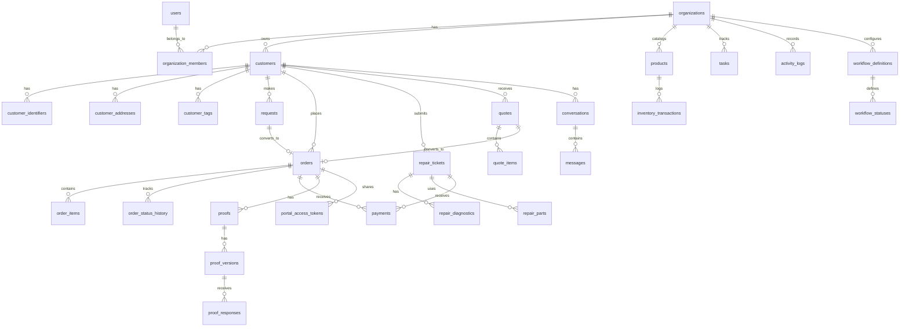

# Data Model — PrintFam Ops

PostgreSQL (via Supabase). All primary keys are `uuid` (`gen_random_uuid()`). All tenant-owned tables carry `organization_id uuid not null references organizations(id)`. Standard audit columns on every table unless noted: `created_at timestamptz not null default now()`, `updated_at timestamptz not null default now()`, `created_by uuid references users(id)`. Soft delete (`deleted_at timestamptz`) is used on user-facing records that can be "deleted" but must survive for audit/reporting (customers, orders, requests, repair_tickets, quotes, products); hard delete is fine for pure logs (activity_logs, notifications).

Row Level Security is enabled on every tenant-owned table; policy shape is `organization_id = current_org_id()` where `current_org_id()` resolves from the authenticated session's active membership. Full policy design in `security.md`.

## Entity relationship overview

## Tenant & identity

### organizations
| Column | Type | Notes |
|---|---|---|
| id | uuid PK | |
| name | text | |
| slug | text unique | |
| logo_url | text | nullable |
| brand_color_primary | text | hex, nullable |
| contact_email | text | |
| contact_phone | text | nullable |
| subscription_plan | text | default `'internal'` for PrintFam; SaaS plan key later |
| settings | jsonb | see `organization_settings` below for structured settings; this is overflow/free-form |
| created_at, updated_at | timestamptz | |

### organization_members
| Column | Type | Notes |
|---|---|---|
| id | uuid PK | |
| organization_id | uuid FK | |
| user_id | uuid FK → users | |
| role_id | uuid FK → roles | |
| status | text | `active` / `invited` / `suspended` |
| invited_by | uuid FK → users, nullable | |
| created_at | timestamptz | |
| — unique(organization_id, user_id) | | |

### users
| Column | Type | Notes |
|---|---|---|
| id | uuid PK | mirrors Supabase `auth.users.id` |
| email | text unique | |
| full_name | text | |
| avatar_url | text | nullable |
| created_at | timestamptz | |

*Not organization-scoped — a user can belong to multiple orgs via `organization_members`.*

### roles
| Column | Type | Notes |
|---|---|---|
| id | uuid PK | |
| key | text | `owner` / `manager` / `team_member` — global, not per-org, in v1 |
| label | text | display label, editable later without changing `key` |

## Customers

### customers
| Column | Type | Notes |
|---|---|---|
| id | uuid PK | |
| organization_id | uuid FK | |
| display_name | text | |
| phone | text | nullable |
| email | text | nullable |
| preferred_contact_method | text | enum: instagram/text/tiktok/email/phone/in_person/other |
| notes | text | |
| total_spent | numeric | denormalized, recomputed on payment write |
| outstanding_balance | numeric | denormalized, recomputed on payment/order write |
| deleted_at | timestamptz | nullable |
| created_at, updated_at, created_by | | |
| — index (organization_id, phone), (organization_id, email) | | |

### customer_identifiers
Normalizes cross-channel identifiers for duplicate detection (source spec: phone/email/Instagram/TikTok/Shopify).
| Column | Type | Notes |
|---|---|---|
| id | uuid PK | |
| customer_id | uuid FK | |
| organization_id | uuid FK | denormalized for RLS simplicity |
| kind | text | `phone` / `email` / `instagram` / `tiktok` / `shopify_customer_id` |
| value | text | |
| — unique (organization_id, kind, value) | | enforces "no two customers share the same Instagram handle in one org," and is the basis of duplicate-detection queries |

### customer_addresses
| Column | Type | Notes |
|---|---|---|
| id | uuid PK | |
| customer_id | uuid FK | |
| organization_id | uuid FK | |
| label | text | `shipping` / `billing` / `other` |
| line1, line2, city, state, postal_code, country | text | |
| is_default | boolean | |

### customer_tags
| Column | Type | Notes |
|---|---|---|
| id | uuid PK | |
| customer_id | uuid FK | |
| organization_id | uuid FK | |
| tag | text | free-form, org-scoped |

## Requests

### requests
| Column | Type | Notes |
|---|---|---|
| id | uuid PK | |
| organization_id | uuid FK | |
| customer_id | uuid FK | |
| title | text | |
| description | text | |
| source | text | instagram/text/shopify/tiktok/email/phone/in_person/returning_customer/other |
| estimated_value | numeric | nullable |
| status_id | uuid FK → workflow_statuses | entity_type = `request` |
| follow_up_date | date | nullable |
| reason_lost | text | nullable |
| converted_order_id | uuid FK → orders, nullable | set on conversion |
| assigned_user_id | uuid FK → users, nullable | |
| deleted_at | timestamptz | |
| created_at, updated_at, created_by | | |

### request_attachments
Thin join used only if a file is request-specific before conversion; general file linkage lives in `attachments` (see Files). Kept separate per source spec's explicit table list, mapped as a view-friendly alias over `attachments where request_id is not null` in application code — no duplicate storage.

## Orders

### orders
| Column | Type | Notes |
|---|---|---|
| id | uuid PK | |
| organization_id | uuid FK | |
| order_number | text | org-scoped sequential, e.g. `PF-1042` |
| customer_id | uuid FK | |
| order_type | text | `custom` / `existing_product` / `bulk` / `service` |
| requires_production | boolean | for `bulk` type, selects which workflow status set applies (see `product_requirements.md` §10) |
| source | text | same enum as requests.source |
| assigned_user_id | uuid FK → users, nullable | |
| status_id | uuid FK → workflow_statuses | entity_type matches order_type |
| converted_from_request_id | uuid FK → requests, nullable | |
| subtotal, discount_total, tax_total, shipping_cost | numeric | |
| deposit_required, deposit_paid | numeric | |
| total | numeric | computed: subtotal - discount + tax + shipping |
| balance_remaining | numeric | denormalized: total - sum(payments) |
| promised_date | date | customer-facing due date |
| internal_deadline | date | nullable, staff-only |
| fulfillment_method | text | `pickup` / `shipping` |
| shipping_address_id | uuid FK → customer_addresses, nullable | |
| tracking_number | text | nullable |
| notes | text | |
| deleted_at | timestamptz | |
| created_at, updated_at, created_by | | |
| — index (organization_id, status_id), (organization_id, promised_date) | | |

### order_items
| Column | Type | Notes |
|---|---|---|
| id | uuid PK | |
| order_id | uuid FK | |
| organization_id | uuid FK | |
| product_id | uuid FK → products, nullable | null for custom line items |
| item_type | text | `catalog_product` / `custom_line_item` / `service` / `repair_charge` |
| description | text | |
| quantity | numeric | |
| unit_price | numeric | |
| size, color, materials | text | nullable, custom-order specs |
| custom_instructions | text | nullable |
| reference_image_attachment_id | uuid FK → attachments, nullable | |

### order_status_history
| Column | Type | Notes |
|---|---|---|
| id | uuid PK | |
| order_id | uuid FK | |
| organization_id | uuid FK | |
| status_id | uuid FK → workflow_statuses | |
| changed_at | timestamptz | **can be backdated** — this is the field Flow B writes historical values into |
| changed_by | uuid FK → users, nullable | null when `source = manual_backfill` and no specific actor is meaningful |
| source | text | `live` / `manual_backfill` |
| note | text | nullable |

*The same shape (status_id/changed_at/changed_by/source/note against a parent id) is reused for `repair_ticket_status_history` and `quote_status_history` — documented once here to avoid repetition.*

## Repairs

### repair_tickets
| Column | Type | Notes |
|---|---|---|
| id | uuid PK | |
| organization_id | uuid FK | |
| ticket_number | text | org-scoped sequential |
| customer_id | uuid FK | |
| device_model | text | |
| serial_number | text | nullable |
| reported_issue | text | |
| error_codes | text | nullable |
| intake_date | date | |
| condition_at_intake | text | |
| accessories_received | text | nullable |
| status_id | uuid FK → workflow_statuses | entity_type = `repair_ticket` |
| diagnostic_fee | numeric | nullable |
| identified_problem | text | nullable |
| recommended_repair | text | nullable |
| customer_approved_at | timestamptz | nullable |
| labor_cost | numeric | nullable |
| final_balance | numeric | denormalized |
| warranty_period_days | integer | nullable |
| completed_summary | text | nullable |
| assigned_user_id | uuid FK → users, nullable | |
| deleted_at | timestamptz | |
| created_at, updated_at, created_by | | |

### repair_diagnostics
| Column | Type | Notes |
|---|---|---|
| id | uuid PK | |
| repair_ticket_id | uuid FK | |
| organization_id | uuid FK | |
| notes | text | |
| checklist | jsonb | array of `{item, result}` |
| logged_by | uuid FK → users | |
| logged_at | timestamptz | |

### repair_parts
| Column | Type | Notes |
|---|---|---|
| id | uuid PK | |
| repair_ticket_id | uuid FK | |
| organization_id | uuid FK | |
| part_name | text | |
| cost | numeric | |
| quantity | integer | |
| status | text | `needed` / `ordered` / `received` / `installed` |

## Products & inventory

### products
| Column | Type | Notes |
|---|---|---|
| id | uuid PK | |
| organization_id | uuid FK | |
| name | text | |
| description | text | |
| category | text | |
| sku | text | |
| selling_price | numeric | |
| cost | numeric | excluded from Team Member/Customer-reachable queries, see `security.md` |
| available_quantity | integer | |
| reserved_quantity | integer | |
| reorder_level | integer | |
| is_active | boolean | |
| customization_options | jsonb | |
| production_notes | text | |
| deleted_at | timestamptz | |
| — unique (organization_id, sku) | | |

### inventory_transactions
| Column | Type | Notes |
|---|---|---|
| id | uuid PK | |
| organization_id | uuid FK | |
| product_id | uuid FK | |
| order_id | uuid FK, nullable | set when triggered by an order status change |
| quantity_delta | integer | positive = restock, negative = consumed |
| reason | text | `order_fulfillment` / `manual_adjustment` / `restock` / `correction` |
| note | text | nullable |
| created_by | uuid FK → users | |
| created_at | timestamptz | |

## Quotes

### quotes
| Column | Type | Notes |
|---|---|---|
| id | uuid PK | |
| organization_id | uuid FK | |
| customer_id | uuid FK | |
| request_id | uuid FK, nullable | |
| status_id | uuid FK → workflow_statuses | entity_type = `quote` |
| subtotal, discount_total, tax_total, shipping_cost, deposit_amount, total | numeric | |
| expires_at | date | |
| terms | text | |
| customer_notes | text | |
| sent_at, viewed_at, approved_at, declined_at | timestamptz | nullable |
| converted_order_id | uuid FK → orders, nullable | |
| deleted_at | timestamptz | |

### quote_items
| Column | Type | Notes |
|---|---|---|
| id | uuid PK | |
| quote_id | uuid FK | |
| organization_id | uuid FK | |
| description | text | |
| quantity | numeric | |
| unit_price | numeric | |
| item_type | text | `product` / `labor` / `material` / `custom` |

## Payments

### payments
| Column | Type | Notes |
|---|---|---|
| id | uuid PK | |
| organization_id | uuid FK | |
| customer_id | uuid FK | denormalized for fast balance queries |
| order_id | uuid FK, nullable | |
| repair_ticket_id | uuid FK, nullable | |
| quote_id | uuid FK, nullable | deposit recorded pre-conversion |
| amount | numeric | |
| method | text | cash/cash_app/zelle/card/shopify/tiktok_shop/square/bank_transfer/other |
| kind | text | `deposit` / `final` / `full` / `refund` |
| paid_at | date | **backdatable**, per Flow B |
| reference_number | text | nullable |
| notes | text | nullable |
| receipt_attachment_id | uuid FK → attachments, nullable | |
| created_at, created_by | | |
| — check: exactly one of order_id/repair_ticket_id/quote_id is non-null | | |

## Proofs

### proofs
| Column | Type | Notes |
|---|---|---|
| id | uuid PK | |
| organization_id | uuid FK | |
| order_id | uuid FK, nullable | |
| repair_ticket_id | uuid FK, nullable | |
| title | text | |
| approval_required | boolean | gates production per Flow F |
| visibility | text | `internal_only` / `customer_visible` |
| latest_status | text | `draft`/`sent`/`approved`/`revision_requested` — denormalized from latest `proof_versions` row for fast list rendering |
| created_at, updated_at, created_by | | |

### proof_versions
| Column | Type | Notes |
|---|---|---|
| id | uuid PK | |
| proof_id | uuid FK | |
| organization_id | uuid FK | |
| version_number | integer | auto-incremented per proof |
| file_attachment_id | uuid FK → attachments | |
| customer_message | text | nullable |
| sent_at | timestamptz | nullable |
| created_at, created_by | | |

### proof_responses
| Column | Type | Notes |
|---|---|---|
| id | uuid PK | |
| proof_version_id | uuid FK | |
| organization_id | uuid FK | |
| response | text | `approved` / `revision_requested` |
| revision_comment | text | required (app-layer + check constraint) when response = `revision_requested` |
| responded_at | timestamptz | |
| responded_via | text | `portal` / `staff_relayed` |

## Communications

### conversations
| Column | Type | Notes |
|---|---|---|
| id | uuid PK | |
| organization_id | uuid FK | |
| customer_id | uuid FK | |
| channel | text | instagram/text/tiktok_shop/shopify/email/phone/in_person/other |
| related_request_id | uuid FK, nullable | |
| related_order_id | uuid FK, nullable | |
| related_repair_ticket_id | uuid FK, nullable | |
| created_at | timestamptz | |

### messages
| Column | Type | Notes |
|---|---|---|
| id | uuid PK | |
| conversation_id | uuid FK | |
| organization_id | uuid FK | |
| direction | text | `incoming` / `outgoing` |
| body | text | |
| occurred_at | timestamptz | backdatable |
| recorded_by | uuid FK → users, nullable | null when sent by a customer via the portal |
| sent_by_customer | boolean | true when written by the portal (Flow J) |
| follow_up_required | boolean | |
| follow_up_date | date | nullable |
| created_at | timestamptz | |

## Files

### attachments
Single generic table covering "files connected to customers, requests, orders, repair tickets, messages, quotes, proofs, products," per source spec — implemented via explicit nullable FKs rather than a polymorphic `(type,id)` pair (see `product_requirements.md` §10.4, `architecture.md`).
| Column | Type | Notes |
|---|---|---|
| id | uuid PK | |
| organization_id | uuid FK | |
| customer_id | uuid FK, nullable | |
| request_id | uuid FK, nullable | |
| order_id | uuid FK, nullable | |
| repair_ticket_id | uuid FK, nullable | |
| message_id | uuid FK, nullable | |
| quote_id | uuid FK, nullable | |
| proof_version_id | uuid FK, nullable | |
| product_id | uuid FK, nullable | |
| file_name | text | |
| file_type | text | mime |
| storage_path | text | Supabase Storage object path |
| visibility | text | `internal_only` / `customer_visible` |
| description | text | nullable |
| uploaded_by | uuid FK → users, nullable | |
| created_at | timestamptz | |
| — check: at least one relation column is non-null | | |

## Tasks

### tasks
| Column | Type | Notes |
|---|---|---|
| id | uuid PK | |
| organization_id | uuid FK | |
| title | text | |
| description | text | nullable |
| assigned_user_id | uuid FK → users, nullable | |
| due_date | date | nullable |
| priority | text | `low`/`normal`/`high`/`urgent` |
| status | text | `open`/`completed`/`dismissed` |
| reminder_at | timestamptz | nullable |
| customer_id, request_id, order_id, repair_ticket_id, proof_id, quote_id | uuid FK, all nullable | same explicit-FK linking pattern as `attachments` |
| auto_suggested | boolean | true for system-generated suggestions (source spec event list) |
| completed_at | timestamptz | nullable |
| created_at, created_by | | |

## Activity & notifications

### activity_logs
Immutable — no update/delete path in the application layer.
| Column | Type | Notes |
|---|---|---|
| id | uuid PK | |
| organization_id | uuid FK | |
| actor_user_id | uuid FK → users, nullable | null when actor is `customer` (portal) or `system` |
| actor_type | text | `user` / `customer` / `system` |
| action | text | e.g. `order.status_changed`, `proof.approved`, `payment.recorded` |
| entity_type | text | e.g. `order` |
| entity_id | uuid | |
| metadata | jsonb | before/after values, free-form per action type |
| occurred_at | timestamptz | backdatable for `manual_backfill`-sourced entries |
| created_at | timestamptz | |
| — index (organization_id, entity_type, entity_id), (organization_id, occurred_at desc) | | |

### notifications
| Column | Type | Notes |
|---|---|---|
| id | uuid PK | |
| organization_id | uuid FK | |
| user_id | uuid FK → users | recipient |
| type | text | matches source spec's notification event list |
| entity_type, entity_id | text, uuid | |
| message | text | |
| read_at | timestamptz | nullable |
| created_at | timestamptz | |

## Integrations & configuration

### integration_connections
Prepared, not activated, per source spec ("do not build fake integrations").
| Column | Type | Notes |
|---|---|---|
| id | uuid PK | |
| organization_id | uuid FK | |
| provider | text | `shopify`/`tiktok_shop`/`instagram`/`gmail`/`sms`/`messenger`/`whatsapp` |
| status | text | `not_connected` (only valid value until a provider is actually built) |
| config | jsonb | nullable, provider-specific, unused in v1 |
| created_at, updated_at | | |

### organization_settings
Structured settings beyond `organizations.settings` jsonb overflow, where a real column is worth having (e.g., for query/filtering).
| Column | Type | Notes |
|---|---|---|
| id | uuid PK | |
| organization_id | uuid FK unique | |
| default_currency | text | default `USD` |
| notification_preferences | jsonb | |
| portal_branding | jsonb | logo/colors override for customer portal |
| business_hours | jsonb | nullable, future scheduling use |

### workflow_definitions
| Column | Type | Notes |
|---|---|---|
| id | uuid PK | |
| organization_id | uuid FK | |
| entity_type | text | `request`/`order_custom`/`order_existing_product`/`order_bulk`/`order_service`/`repair_ticket`/`quote` |
| name | text | |
| is_default | boolean | seeded template vs. org-customized |
| — unique (organization_id, entity_type) | | one active workflow per entity type per org in v1 |

### workflow_statuses
| Column | Type | Notes |
|---|---|---|
| id | uuid PK | |
| workflow_definition_id | uuid FK | |
| organization_id | uuid FK | |
| key | text | stable machine key, e.g. `in_production` |
| label | text | display label, editable (Phase 8 UI) without breaking `key` references |
| sort_order | integer | |
| category | text | `attention` / `in_progress` / `done` / `cancelled` — drives dashboard grouping and badge color, see `design_system.md` |
| color | text | semantic token, not raw hex, e.g. `warning` |
| — unique (workflow_definition_id, key) | | |

*This is the table that makes "no hardcoded statuses across the interface" real: the UI renders whatever `workflow_statuses` rows exist for the record's `workflow_definition_id`, ordered by `sort_order`. v1 seeds every organization with the exact status lists from `product_requirements.md` §9 at creation time; editing them is a Phase 8 Settings screen, not a schema change.*

## Customer portal

### portal_access_tokens
| Column | Type | Notes |
|---|---|---|
| id | uuid PK | |
| organization_id | uuid FK | |
| customer_id | uuid FK | |
| token_hash | text | never store the raw token, see `security.md` |
| scope_type | text | `order` / `quote` / `proof` / `repair_ticket` |
| scope_id | uuid | the single record this token grants access to |
| expires_at | timestamptz | |
| revoked_at | timestamptz | nullable |
| last_used_at | timestamptz | nullable |
| created_at, created_by | | |
| — index (token_hash) | | lookup path for portal requests |

Full token issuance/validation/expiry/IDOR-prevention rules are in `security.md`.

## Indexing summary (beyond PKs/FKs already noted)

- `customers`: (organization_id, display_name) for search/sort; `customer_identifiers`: (organization_id, kind, value) unique, used for both dedupe and lookup.
- `orders`: (organization_id, status_id), (organization_id, promised_date), (organization_id, order_number) unique.
- `repair_tickets`: (organization_id, status_id).
- `payments`: (organization_id, order_id), (organization_id, repair_ticket_id), (organization_id, customer_id) — balance rollups hit these constantly.
- `activity_logs`: (organization_id, entity_type, entity_id), (organization_id, occurred_at desc) — dashboard and detail-page timelines are the hottest read paths in the app.
- `tasks`: (organization_id, assigned_user_id, due_date), (organization_id, status).
- Full-text search: a generated `tsvector` column on `customers` (name/phone/email/identifiers via trigger-maintained denormalization) and on `orders`/`requests` (title/notes) backs global search; Postgres FTS is sufficient at PrintFam's scale and avoids standing up a separate search service in v1.
